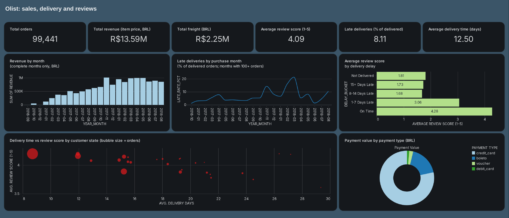
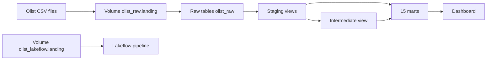
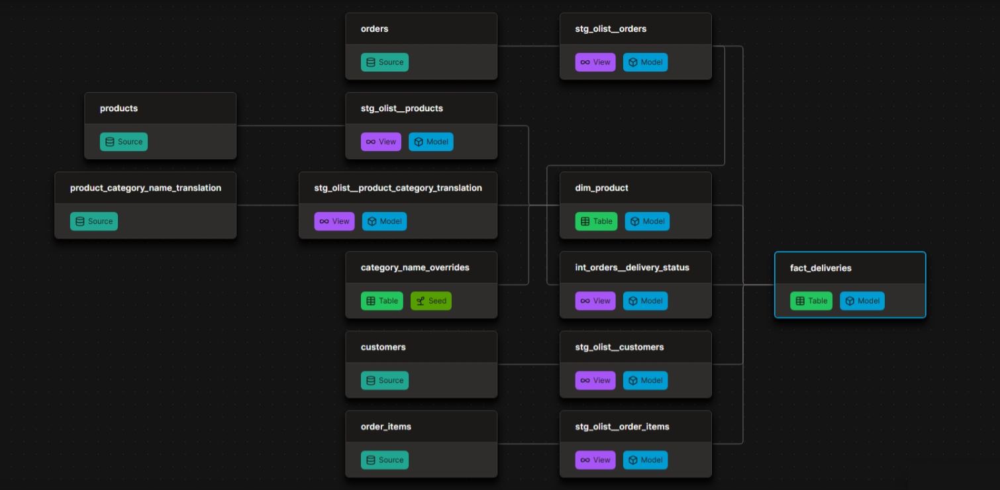
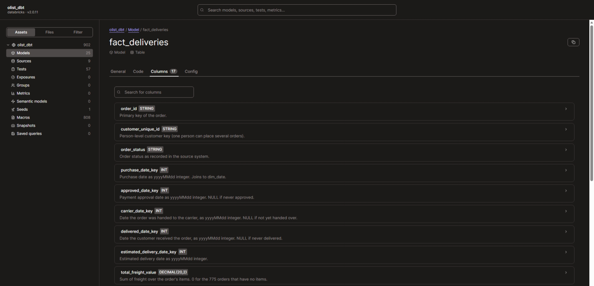
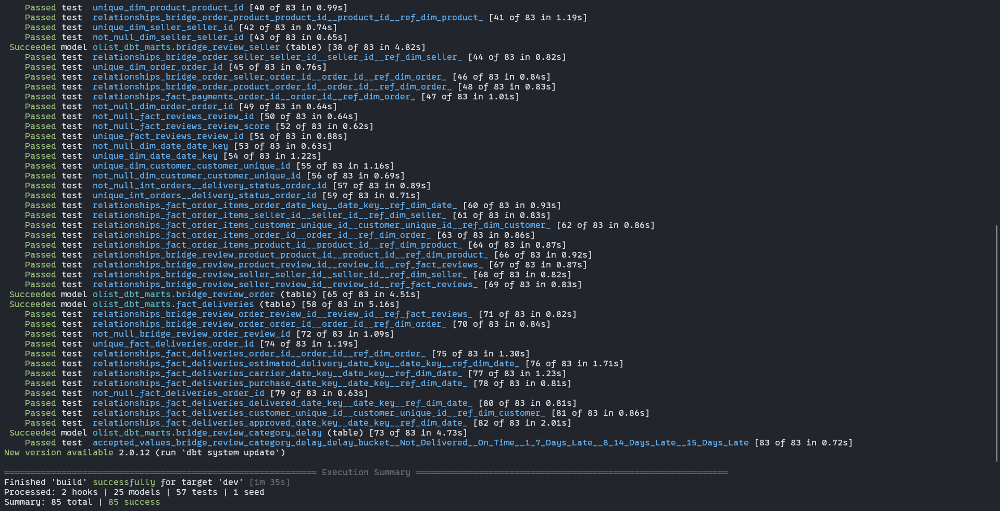
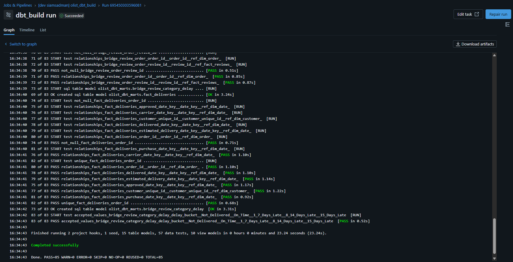
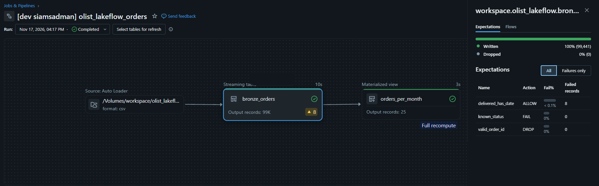
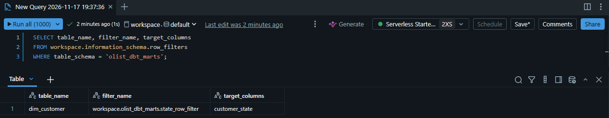

# Olist E-Commerce — dbt Pipeline on Databricks Free Edition

A dbt project that rebuilds the data pipelines behind my three published Olist Power BI dashboards on Databricks Free Edition — 25 models, 57 tests, a Databricks Asset Bundle job, a Lakeflow pipeline with Auto Loader, a Unity Catalog row filter, a published docs site, and a dashboard on top of the marts. Built end-to-end from raw CSVs, with no Fabric and no paid services. Fourth project in the Olist series ([Part 1: Sales & Revenue Performance](https://github.com/siamsadman/olist-sales-dashboard) · [Part 2: Logistics & Delivery Performance](https://github.com/siamsadman/olist-logistics-dashboard) · [Part 3: Customer Experience & Satisfaction](https://github.com/siamsadman/olist-customer-satisfaction-dashboard)).

**[Live dbt docs ▸](https://olist-dbt-docs.vercel.app)**

> **About this project:** I built this to learn dbt and Databricks by doing, using the pipelines behind my three Olist dashboards as the exercise. I'm a BI Developer coming from the Microsoft stack, not a dbt expert, and I used AI (Claude) as a guide throughout. Every mart is reconciled against my original projects, and the differences are documented.



*A Databricks dashboard reading the dbt marts: six KPIs, monthly revenue, late-delivery rate, review score by delivery delay, delivery time vs review score by customer state, and payment mix.*

---

## Why This Project

My three Olist projects were built with SQL Server and Power BI: SQL and pandas scripts prepared the data, and the models and measures lived in Power BI.

- [Part 1 — Sales & Revenue Performance](https://github.com/siamsadman/olist-sales-dashboard)
- [Part 2 — Logistics & Delivery Performance](https://github.com/siamsadman/olist-logistics-dashboard)
- [Part 3 — Customer Experience & Satisfaction](https://github.com/siamsadman/olist-customer-satisfaction-dashboard)

This project asks a different question: can the same pipelines be rebuilt as version-controlled analytics engineering code, with tests, lineage, documentation and a scheduled run? Every mart is reconciled against the numbers published in those projects, and where my numbers differ, the difference is explained instead of forced to match.

---

## Tech Stack

- **Databricks Free Edition** — serverless SQL warehouse, Unity Catalog volumes and tables, Lakeflow Declarative Pipelines, AI/BI dashboards
- **dbt v2** — models, tests, seeds, hooks and documentation (the locally installed version is 2.0.11; the Databricks job runs dbt 1.12.6)
- **Databricks Asset Bundles and CLI** — deploys the dbt job and the Lakeflow pipeline from the repository
- **Python** — a standard-library script that splits the orders file into two batches for the Auto Loader demo
- **Vercel** — hosts the generated dbt documentation site
- **Git and GitHub** — version control and the public repository

---

## At a Glance

| What | Result |
|---|---|
| Raw layer | 9 all-text tables loaded from the Olist CSVs |
| dbt models | 25: 9 staging views, 1 intermediate view, 15 marts |
| Tests | 57 dbt tests, all passing |
| Reconciliation | Every mart checked against the original projects; differences documented (see below) |
| Orchestration | A Databricks Asset Bundle deploys a serverless job that runs `dbt build` (83 of 83 pass) |
| Add-on A | A Lakeflow Declarative Pipeline with Auto Loader and data-quality expectations |
| Add-on B | A Unity Catalog row filter on `dim_customer`, kept in place by dbt hooks |
| Docs | dbt Docs v2 static site on Vercel |

Source data: the [Brazilian E-Commerce Public Dataset by Olist](https://www.kaggle.com/datasets/olistbr/brazilian-ecommerce) on Kaggle.

---

## Pipeline Architecture







*The generated dbt docs for `fact_deliveries`: every column has a description. The sidebar shows the project totals: 25 models, 57 tests, 9 sources, 1 seed.*

| Layer | Schema | Materialization | Contents |
|---|---|---|---|
| Raw (bronze) | `workspace.olist_raw` | tables | 9 tables, every column loaded as text — dbt does all casting and cleaning |
| Staging | `workspace.olist_dbt_staging` | views | 9 models, one per raw table: types cast, columns renamed, source typos fixed |
| Intermediate | `workspace.olist_dbt_intermediate` | view | `int_orders__delivery_status` — one row per order with the delivery and lateness logic shared by two marts |
| Marts | `workspace.olist_dbt_marts` | tables | 15 models in star-schema style |
| Seed | `workspace.olist_dbt` | table | `category_name_overrides` — three manual category mappings |

**Marts, by the original project they rebuild:**

- **Part 1 — Sales & Revenue:** `fact_order_items`, `fact_payments`, `dim_customer` (key = `customer_unique_id`), `dim_seller`, `dim_product`, `dim_order`, `dim_date`
- **Part 2 — Logistics & Delivery:** `fact_deliveries` (true NULL dates, never 1900-01-01), `bridge_order_seller`, `bridge_order_product`
- **Part 3 — Customer Experience:** `fact_reviews`, `bridge_review_order`, `bridge_review_seller`, `bridge_review_product`, `bridge_review_category_delay`

---

## Data Quality: What I Found and How I Handled It

| Issue Found | Resolution |
|---|---|
| 2,965 orders have no delivery date (blank in the CSV) | `read_files` turns the blanks into true NULLs, and staging keeps them — no placeholder dates, so the 1900-01-01 problem from the earlier projects cannot recur |
| `review_id` is not unique in the reviews file: 98,410 distinct values across 99,224 rows | The real grain is `(review_id, order_id)`, enforced by a singular test; `fact_reviews` keeps one row per review (98,410) and `bridge_review_order` keeps every pair (99,224) |
| Review comments contain line breaks and quotes, which breaks a default CSV load | The raw load for that file uses the multi-line and quote-escape options; the correct count is 99,224 rows |
| 610 products have no category, and 13 more sit in two categories missing from the translation file (623 untranslated in total) | The 610 become `Unknown`; the other two categories are mapped by hand in a seed (`category_name_overrides`) |
| 2 products have no weight | Set to 0, following the original rule — this is a made-up value for two products, not a measurement |
| 775 orders have no items | `order_value` and weight stay NULL in `fact_deliveries` instead of being turned into zeros |
| Geolocation has coordinates outside Brazil (latitude -36.6 to +45.1, longitude -101.5 to +121.1) | No current mart uses the table; if one does, the points will need to be filtered or flagged |
| 8 orders are marked `delivered` but have no delivery date | Caught by a Lakeflow expectation (see Add-on A); I had previously noted "2" because of a netted-out comparison |



*A local `dbt build` on dbt v2 (2.0.11): 25 models, 57 tests, 1 seed and 2 hooks, 85 of 85 succeeded in 1 minute 35 seconds. The Databricks job runs dbt 1.12.6 and gives the same result.*

---

## Reconciliation with the Original Projects

Each mart was compared with the numbers in the original project READMEs and SQL scripts, recomputed from the raw files. All of these match:

| Mart | Result |
|---|---|
| `fact_order_items` | 112,650 rows; price 13,591,643.70; freight 2,251,909.54 |
| `fact_payments` | 103,886 rows; 16,008,872.12 |
| `dim_customer` / `dim_seller` / `dim_product` | 96,096 / 3,095 / 32,951 |
| `fact_deliveries` | 99,441 rows; `is_late` 0 = 88,649, 1 = 7,827, NULL = 2,965; average delivery 12.50 days; average days vs estimate -11.88 |
| `bridge_order_seller` / `bridge_order_product` | 100,010 / 102,425 |
| `fact_reviews` | 98,410 rows; mean score 4.0888; 43.07% with a comment |
| `bridge_review_order` | 99,224 rows; 88,658 delivered on time, 7,701 late, 2,865 not delivered; average score 4.29 on time vs 2.57 late |
| `bridge_review_seller` / `bridge_review_product` | 99,549 / 102,172 |

### Where My Numbers Differ

| Difference | What I did |
|---|---|
| `bridge_review_category_delay` has **98,991 rows**, the original reports **103,831** | The published count only reproduces when the same join runs *without* `DISTINCT` (that returns exactly 103,831), although the original SQL contains `SELECT DISTINCT`. I kept `DISTINCT`: one row per review, category and delay bucket. The 215 rows above the 98,776 review-and-category pairs come from reviews linked to more than one order that land in different buckets. The original README explains the surplus as reviews spanning several categories; in my analysis most of it is duplicate rows. |
| `bridge_review_order.is_late` | The original SQL compares dates, but the published figures (88,658 / 7,701 / 2.57 / 4.29) only reproduce with a full timestamp comparison, the same definition as `fact_deliveries` (a date comparison gives 2.27 for late orders). I used timestamps. My hypothesis, not proven, is that the SQL file is an earlier version than the one that produced the published numbers. |
| `dim_customer` address | Taken from each customer's **latest** order; the original used an independent `MAX()` per column. 252 customers (0.26%) have more than one address in the source, so those rows may differ. |
| `dim_order` has **99,441 rows**, the published Sales model has **98,666** | The Sales model leaves out the 775 orders with no line items. The 99,441 target came from an approximate figure (`~99,441`) in a SQL comment, not from the model. I kept every order, so `fact_deliveries` and `dim_order` agree on 99,441 orders. |
| `dim_date` has **800 rows**, the Part 1 README says about 774 | The table spans 2016-09-04 to 2018-11-12; extending it to cover estimated delivery dates for Part 2 added 26 rows. |
| `dim_date.week_of_year` | Emulates SQL Server's `DATEPART(WEEK)` — Sunday-first default assumed; 2017-12-31 is week 53. |
| Spark `SUM` of `decimal(10,2)` | Returns `decimal(20,2)`. The values are identical; only the declared type is wider. |

---

## Key Modeling Decisions

**Cast, don't try_cast.** Staging uses `cast`, so bad data fails the build instead of turning into a silent NULL. Money is `decimal(10,2)`, coordinates are `double`, and timestamps are named `*_at`.

**Day differences are computed on dates, not timestamps.** SQL Server's `DATEDIFF` counts date boundaries, and the original numbers depend on that (12.50 average delivery days, -11.88 versus the estimate). Using timestamps would shift the averages slightly.

**Lateness has one definition.** `is_late`, `delay_days` and `is_delivered` live in one intermediate model, `int_orders__delivery_status`, and both `fact_deliveries` and `bridge_review_order` read from it. It was added late, only after two marts needed the same rule, and the numbers did not change when I refactored the marts onto it.

**A late-delivery quirk is kept on purpose.** An order delivered later on the estimated day counts as late (`is_late = 1`), while `days_vs_estimate` is 0, because `is_late` compares full timestamps. The original behaves the same way, so I kept it and documented it.

**Raw tables are all text.** The raw layer holds no types and no cleaning, so every cast and every decision is visible in the dbt code and can be tested.

---

## Orchestration — Databricks Asset Bundle

`databricks.yml` defines a serverless job with one task that runs `dbt build` against the SQL warehouse, deployed with the Databricks CLI:

```powershell
databricks bundle validate --profile olist
databricks bundle deploy   --profile olist
databricks bundle run olist_dbt_job --profile olist
```

First run: succeeded in about 1 minute 45 seconds, **83 of 83** passed (25 models, 57 tests, 1 seed).



*The screenshot is a later run of the same job (1 minute 17 seconds, same result): 85 of 85 including the two project hooks.*

- The job runs **dbt 1.12.6** (dbt-core with adapter 1.13.0), while I develop locally with **dbt v2 (2.0.11)**. The same project and the v2-style test YAML ran unchanged under both.
- The job overwrites the same `workspace.olist_dbt*` tables as local builds.
- The bundle's `dev` target uses development mode, so the job is named `[dev <user>] olist_dbt_build`.

---

## Add-on A — Lakeflow Declarative Pipeline (Auto Loader and Expectations)

`pipelines/olist_lakeflow/transformations/orders.sql` defines a small Lakeflow Declarative Pipeline in schema `workspace.olist_lakeflow`, separate from the dbt tables.

- **`bronze_orders`** — a streaming table that reads CSV files from the volume `olist_lakeflow.landing` with Auto Loader (`STREAM read_files`) and adds `source_file` and `loaded_at` columns. Three expectations show the three behaviours:

| Expectation | Condition | On violation |
|---|---|---|
| `delivered_has_date` | status is not `delivered`, or the delivery date is present | **warn** — keep the row, count it |
| `valid_order_id` | `order_id` is present and 32 characters long | **drop** the row |
| `known_status` | status is one of the eight known values | **fail** the update |

- **`orders_per_month`** — a materialized view counting orders by purchase month.



**The stream is simulated.** The Olist data is static (2016 to 2018), so I split the orders file into two files with `scripts/split_orders.py` (before 2018: 45,430 rows; from 2018: 54,011 rows) and uploaded them by hand. In the first run Auto Loader read only batch 1; after I uploaded batch 2, a normal run processed only the new file. Both files together give 99,441 rows, matching the orders table, and the materialized view has 25 months that add up to 99,441.

**What the expectations found and did not find:**

- **8 delivered orders have no delivery date** — 2 in batch 1, 6 in batch 2.
- The **drop** and **fail** expectations fired **zero** times on this data (no bad IDs, no unknown statuses). They demonstrate the mechanism; they did not clean anything.

---

## Add-on B — Unity Catalog Row Filter

`dim_customer` has a row filter: members of the workspace `admins` group see all customers, everyone else sees only customers in state `SP`.

- The filter function `workspace.olist_dbt_marts.state_row_filter` is created by an `on-run-start` hook in `dbt_project.yml` and attached by a `post_hook` on `dim_customer`.
- **Why hooks:** a dbt rebuild of the table **drops** the filter (verified: no filter in `information_schema.row_filters` after `dbt build --select dim_customer`). With the hooks, the filter is present after every build, in both dbt v2 locally and dbt 1.12 in the job.



**Limits I want to be clear about:**

- I tested the filter by temporarily swapping in a rule that referenced a group I do not belong to — the count dropped from 96,096 to 40,296 rows and one state. I did **not** test with a second real user.
- A non-admin reading `dim_customer` sees only SP, and so would any test or model that reads it. dbt must run as a user or service principal with full access.
- The catalog and schema names are hard-coded in the hooks.

---

## Dashboard

The dashboard was built by hand in the Databricks dashboard editor on top of the marts, with six datasets, each a SQL query against the marts. The bundle does not deploy it. `dashboards/olist_overview.lvdash.json` is an export of the published dashboard, kept as a record of its datasets and layout; I have not tested re-importing it into a fresh workspace.

- The late-delivery line groups by **purchase** month and only includes months with 100 or more orders — months with a handful of orders gave meaningless rates (for example 100% in September 2016).
- The scatter assigns each order to its customer's latest-order state (see the `dim_customer` difference above).
- Prices are labelled BRL in the charts, following the dataset's origin.

---

## Notable Findings

- **The review score collapses once a delivery is late.** Orders delivered on time average 4.28; orders 1–7 days late average 3.06; 8–14 days late 1.68; 15+ days late 1.73. Orders that were never delivered average 1.81 — *higher* than the two longest-delay buckets. These figures are at the grain of `bridge_review_category_delay` (one row per review, category and bucket), which is why they differ slightly from the Part 3 numbers.
- **Delivery time and satisfaction move together across states, with clear exceptions.** São Paulo delivers fastest (8.7 days) and scores 4.20 across 41,752 orders; Roraima is slowest (29.3 days) and lowest (3.61) but has only 46 orders. Amazonas and Amapá are almost as slow (26.4 and 27.2 days) yet score 4.20 and 4.19 — on 148 and 68 orders, so small-sample noise is likely. Rio de Janeiro scores 3.89 on 12,854 orders despite a mid-range 15.2 days. This is a pattern, not proof that delivery time causes the scores.
- **Revenue peaked in November 2017 and then plateaued.** The month reached 1,010,271.37, and the complete months of 2018 stayed between roughly 0.84 and 1.0 million.
- **The late-delivery rate is 8.11% overall but not steady.** The monthly line shows its highest points around November 2017 and March 2018.
- **Credit cards carry most of the payment value.** Credit card accounts for 78.3% of the total, boleto 17.9%, voucher 2.4% and debit card 1.4%.
- **Delivery beats the estimate by almost 12 days on average** (-11.88), with an average of 12.50 days from purchase to delivery.

---

## Setup

**You need:** a [Databricks Free Edition](https://docs.databricks.com/aws/en/getting-started/free-edition) account, Python (only to install dbt with pip), the Databricks CLI (version 0.205 or later; I used 1.26.0), and the Olist CSV files from Kaggle.

1. **Databricks objects and raw data.** In the SQL editor, create schema `workspace.olist_raw` and a managed volume `landing` in it, upload the nine CSV files to the volume, then run `setup/01_load_raw.sql`. It creates the nine raw tables with every column as text. Row counts should match the reconciliation tables above — for example 99,441 orders and 99,224 review rows.
2. **dbt v2.** Create a virtual environment and install dbt:

   ```powershell
   python -m venv .venv
   .\.venv\Scripts\Activate.ps1
   python -m pip install dbt
   ```

   dbt v2 is a standalone binary, so no `dbt-databricks` package is needed (the connection uses ADBC drivers).
3. **Connection profile.** Create `~/.dbt/profiles.yml` with a profile named `olist_dbt` pointing at your Databricks SQL warehouse (host, HTTP path, a personal access token, catalog `workspace`, schema `olist_dbt`). Keep this file outside Git. Use the connection values shown in your warehouse's settings.
4. **Build.** From the repository root:

   ```powershell
   dbt build
   ```

   Expected: 83 pass (25 models, 57 tests, 1 seed), or 85 including the two project hooks.
5. **Docs.** To regenerate the documentation site:

   ```powershell
   dbt build --write-index --static-analysis strict
   dbt docs generate --no-compile --output-dir docs
   ```

6. **Databricks job and pipeline.** Log in with the CLI, then validate, deploy and run:

   ```powershell
   databricks auth login --host https://<your-workspace-host> --profile olist
   databricks bundle validate --profile olist
   databricks bundle deploy   --profile olist
   databricks bundle run olist_dbt_job --profile olist
   databricks bundle run olist_lakeflow_pipeline --profile olist
   ```

   The pipeline reads from the volume `workspace.olist_lakeflow.landing`: create it, put the files from `scripts/split_orders.py` there (edit the two paths at the top of the script first), and run the pipeline. `warehouse_id` in `databricks.yml` is a variable; set it to your own SQL warehouse.

**Windows and Anaconda caveat.** Anaconda sets a user environment variable `SSL_CERT_FILE` that made the Databricks CLI fail with "certificate signed by unknown authority". In the terminal where you run the CLI, run `$env:SSL_CERT_FILE = $null` first. It only affects that terminal session.

**Free Edition limits that shaped the project:** serverless compute only (no custom clusters), one 2X-Small SQL warehouse, one active pipeline per pipeline type, and a daily compute quota whose size is not published.

---

## What Went Wrong and What I Learned

| What happened | What I learned |
|---|---|
| A dbt rebuild of `dim_customer` silently dropped the Unity Catalog row filter | A table that dbt recreates loses anything attached to it afterwards; attach it in a post-hook and create the function in an `on-run-start` hook, and verify with `information_schema` instead of trusting that the build passed |
| The Databricks CLI failed with "certificate signed by unknown authority" | Anaconda's `SSL_CERT_FILE` environment variable was overriding the certificate store; clearing it in the terminal fixed it |
| After adding expectations to an existing streaming table, a normal run checked nothing | A streaming table does not re-read files it has already processed, so the expectations only see new data; a full refresh was needed to check the existing file |
| Deleting the Lakeflow pipeline in the UI did not delete its tables | I dropped `bronze_orders` and `orders_per_month` by hand before deploying the bundle's pipeline, which then rebuilt both from the two files in the volume |
| I recorded "2 delivered orders without a delivery date" — the real number is 8 | Comparing two totals can hide offsetting differences; the Lakeflow expectation counted the rows directly and found 8 |
| Three published numbers did not match the published SQL | I trusted the numbers I could reproduce and wrote down the difference instead of changing the data to fit |
| The intermediate layer did not exist at first | Two marts needed the same lateness rule, so I added it afterwards and re-verified every number |

---

## Limits

- **Docs:** dbt Docs v2 is labelled alpha. The site loads DuckDB-WASM from a public CDN (cdn.jsdelivr.net) and shows a promotional "Upgrade" box that is part of the viewer. I have not tested embedding it in an iframe.
- **Raw layer:** loaded by running SQL by hand, with no automated ingestion for the nine main tables.
- **Streaming:** the Auto Loader stream is a simulation on static data.
- **Row filter:** tested with a simulated non-admin only.
- **Dashboard:** not version-controlled in this repository.
- **Free Edition:** results were checked in November 2026, and Free Edition limits can change.

---

## Repository Structure

```
/olist-dbt-databricks
├── README.md
├── LICENSE
├── databricks.yml                — Asset Bundle: dbt job and Lakeflow pipeline
├── dbt_project.yml               — project settings, layer config, on-run-start hooks
├── models/
│   ├── staging/                  — 9 views, sources and tests
│   ├── intermediate/             — int_orders__delivery_status
│   ├── marts/                    — 15 marts, descriptions and tests
│   └── overview.md               — landing page text for the dbt docs
├── seeds/
│   └── category_name_overrides.csv
├── tests/                        — 3 singular grain tests
├── pipelines/
│   └── olist_lakeflow/
│       └── transformations/
│           └── orders.sql        — Auto Loader streaming table, expectations, materialized view
├── scripts/
│   └── split_orders.py           — splits the orders file into two batches for the Auto Loader demo
├── dashboards/
│   └── olist_overview.lvdash.json — export of the published Databricks dashboard (not deployed by the bundle)
├── setup/
│   └── 01_load_raw.sql           — loads the nine raw tables from the CSVs
├── docs/                         — generated dbt Docs v2 site, deployed on Vercel (do not edit by hand)
└── images/
    ├── dashboard_overview.png
    ├── dbt_docs_columns.png
    ├── dbt_build_local.png
    ├── lineage_graph.png
    ├── job_run_success.png
    ├── lakeflow_pipeline.png
    └── row_filter.png
```

The raw CSV files are not in the repository (`*.csv` is ignored, except the seed).

---

## About

Built by Siam Sadman as part of a portfolio project, working with an AI assistant (Claude). This README was drafted with AI and reviewed by me.

[www.linkedin.com/in/siam-sadman](http://www.linkedin.com/in/siam-sadman)
